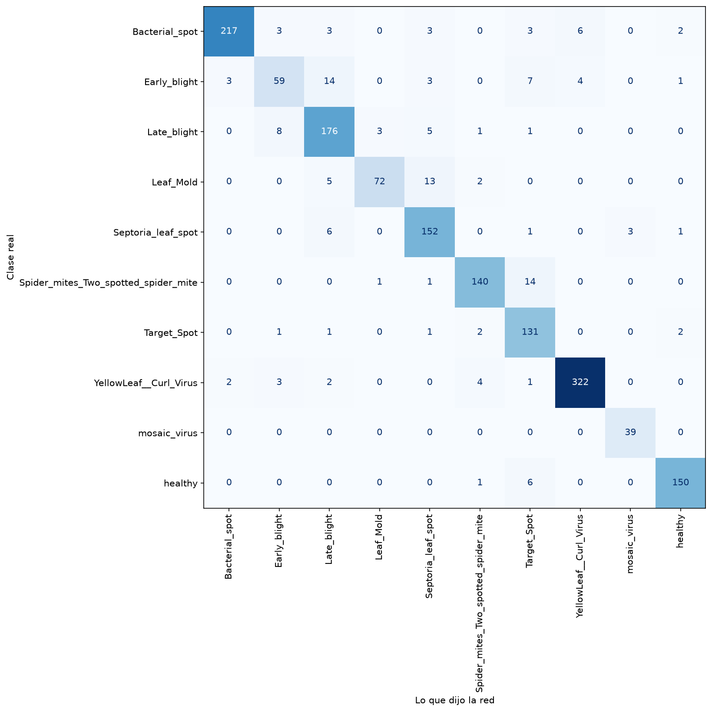

# Detección de enfermedades en hojas de tomate

Proyecto de ciencia de datos que clasifica fotos de hojas de tomate para detectar
si la planta está sana o qué enfermedad tiene (10 clases).
Compara un modelo clásico de machine learning, una red convolucional propia y
transfer learning con ResNet18.

Datos: conjunto PlantVillage, solo las 16.011 fotos de tomate.

## Resultados

| Modelo | Notebook | Exactitud en prueba |
|---|---|---|
| Random Forest (6 características de color) | 02 | 0,72 |
| CNN propia (2 capas de convolución) | 04 | 0,91 |
| CNN propia con aumento de datos | 06 | 0,88 |
| ResNet18 con aumento de datos y ajuste fino | 07 | **0,95** |

- **Mirar formas y no solo colores fue el salto más grande:** el recall del tizón temprano pasó
  de 0,34 (Random Forest) a 0,78 (CNN propia) y a 0,90 (ResNet18).
- **El aumento de datos eliminó el sobreajuste,** pero la red propia era demasiado chica para
  aprovecharlo. Con ResNet18 sí funcionó.
- **Solo 2 de 1.444 hojas enfermas** de la prueba fueron clasificadas como sanas.
- **Límite:** los tres modelos fallan con fotos de campo (varias hojas, fondo de tierra), porque
  todas las fotos de entrenamiento son de laboratorio. El próximo paso no es un modelo más grande,
  sino entrenar con fotos reales.



## Contenido

| Archivo | Qué hace |
|---|---|
| `notebooks/01_exploracion.ipynb` | Exploración de las fotos y cantidad por clase |
| `notebooks/02_modelo_clasico.ipynb` | Características de color, Random Forest y comparación de modelos clásicos |
| `notebooks/03_redes_neuronales.ipynb` | Una neurona a mano y filtros de convolución |
| `notebooks/04_cnn.ipynb` | Entrenamiento y evaluación de la CNN propia |
| `notebooks/05_demo.ipynb` | Demostración: aplicación para clasificar fotos |
| `notebooks/06_aumento_datos.ipynb` | La misma CNN con aumento de datos |
| `notebooks/07_transfer_learning.ipynb` | ResNet18 preentrenada con ajuste fino |
| `src/descargar_datos.py` | Descarga PlantVillage desde Kaggle a `data/` |
| `src/preparar_datos.py` | Copia solo las clases de tomate a `data/tomate/` |
| `modelos/red_tomate.pt` | Pesos de la CNN propia |
| `modelos/red_tomate_aumento.pt` | Pesos de la CNN propia con aumento de datos |
| `modelos/red_tomate_resnet.pt` | Pesos de ResNet18 ajustada |
| `imagenes/` | Gráficos del proyecto |

## Cómo ejecutarlo

Desde la carpeta del proyecto, en Windows:

```bash
python -m venv .venv
.venv\Scripts\python -m pip install -r requirements.txt
.venv\Scripts\python src\descargar_datos.py
.venv\Scripts\python src\preparar_datos.py
```

Después abrir los notebooks en orden, con el kernel del entorno `.venv`.

En CPU, el entrenamiento de la CNN propia tarda alrededor de una hora, y el de ResNet18
unos 35 minutos. Para usar los modelos sin entrenar, cargar los pesos de la carpeta `modelos/`.

## Demostración

Ejecutar todas las celdas de `notebooks/05_demo.ipynb` (no entrena nada, tarda segundos)
y abrir `http://127.0.0.1:7860` en el navegador. Se puede subir una foto o elegir una de
las fotos de ejemplo, que son de la prueba y la red nunca vio.

El modelo se entrenó con fotos de laboratorio: con fotos de campo puede equivocarse,
incluso mostrando 100% de seguridad.